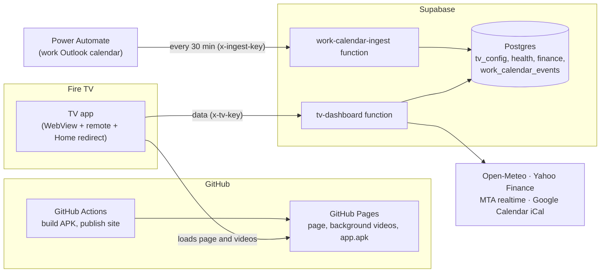

# TV Dashboard

A minimal home screen for a Fire TV: a looping background video with the time, weather,
portfolio, health stats, calendar, subway departures and a trip countdown on top, and a row of
favorite apps in the middle. It replaces the ad heavy stock home screen as far as Fire OS allows.



## What's on screen

| Area | Shows | Source |
|---|---|---|
| Top left | Time, date, stock and crypto portfolio with today's change, 30 day line, holdings | `stocks_crypto_history`, live quotes |
| Top right | Weather and 3 day forecast, trip countdown, Gmail unread count, next meetings (personal and work) | Open-Meteo, `tv_config.trips`, `tv_metrics` (Apps Script), Google Calendar iCal, `work_calendar_events` |
| Top center | Settings, Inputs and Wi‑Fi buttons; Wi‑Fi shows network name and signal | Fire OS |
| Middle | Favorite apps and a News folder; dims when idle. Below them, what Spotify is playing | Installed apps on the TV, Spotify's media session |
| Bottom | Recovery, sleep, strain, today's workout, body composition trend, calorie balance (burned vs eaten), subway departures | `whoop_*`, `training_plan`, `body_composition`, `nutrition_log`, MTA realtime |
| Background | Looping videos, switched with the remote | `videos/` |

## Remote

| Button | Action |
|---|---|
| Up / Down | Move between the top buttons (Settings, Inputs, Wi‑Fi) and the app row |
| Left / Right | Move along the row |
| OK | Open the app or screen (a folder opens a small row of apps) |
| Back | Close an open folder |
| ⏪ / ⏩ | Previous / next background video (previous / next track while Spotify is playing) |
| ☰ Menu | Refresh the dashboard |
| Home | Comes back to the dashboard (after a brief flash of the stock home) |

The Wi‑Fi button shows the network name and signal; the name needs the location permission the
app asks for on first launch.

## Repository

```
web/                      the dashboard page (index.html), background player (bg.js), app icons (icons/)
videos/                   background clips; compressed for the TV on publish
supabase/functions/       tv-dashboard (data for the page), work-calendar-ingest (work calendar), tv-metrics-ingest (Gmail count)
android/                  the TV app: full screen WebView, app row bridge, Home redirect, screensaver
.github/workflows/        pages.yml (publish site), app.yml (build and release the APK)
docs/                     architecture, TV setup, data and config, Power Automate flow, debloat list
```

## Common changes

* **Background videos:** add or remove `.mp4` / `.mov` files in `videos/` (up to 25 MB through the GitHub website). They are trimmed to 40 s, made silent and compressed to 1080p on publish.
* **Location, time zone, trips, subway stop:** edit the `tv_config` row in Supabase ([docs/data.md](docs/data.md)). No code change or publish needed.
* **Look and layout:** edit `web/index.html`. The TV picks it up on its daily reload, or press ☰ Menu.
* **App row:** edit the list in `android/app/src/main/java/app/tvdashboard/TvBridge.java` and reinstall the app ([docs/tv-setup.md](docs/tv-setup.md)).
* **Folders:** `NEWS` in `TvBridge.java` lists the apps by the name they show on the TV (e.g. "cbs news"); installed matches appear inside the News tile.
* **Website tiles:** add `{"label": "Name", "url": "https://...", "icon": "name"}` to `web/sites.json` and publish; no reinstall. They open in Silk (the TV's browser, with a remote cursor). `icon` is a file in `web/icons/` without `.webp`; leave it out for the globe icon.
* **App icons:** round 192×192 WebP files in `web/icons/`, mapped by package in `ICONS` in `web/index.html`. Apps without one use the TV's own banner.

## Docs

* [Architecture](docs/architecture.md): components, request flow, publish pipeline, security
* [TV setup and recovery](docs/tv-setup.md): install, Home button redirect, troubleshooting
* [Data and config](docs/data.md): tables, `tv_config`, secrets, API response
* [Work calendar flow](docs/power-automate.md): the Power Automate flow, step by step
* [Gmail unread count](docs/gmail.md): the Apps Script that sends the count
* [Debloat](docs/debloat.md): what was disabled on the TV and how to undo it

## Privacy

This repository holds no personal data: no keys, locations, names or calendar entries. The page
asks the data function for everything personal, and the function only answers callers that
present the TV key, which lives on the TV. Personal settings live in the private `tv_config`
table; secrets live in Supabase function secrets.
