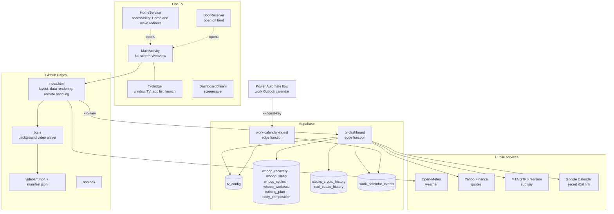
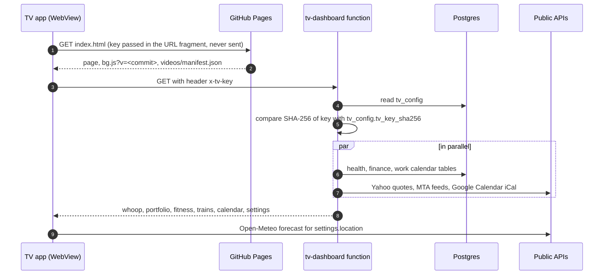
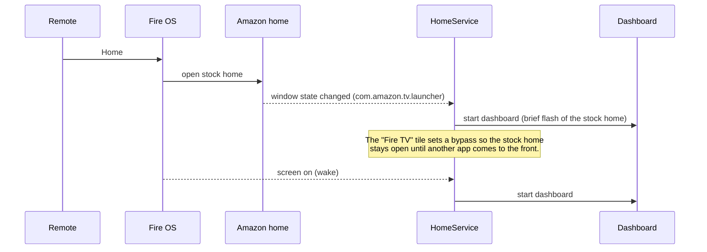
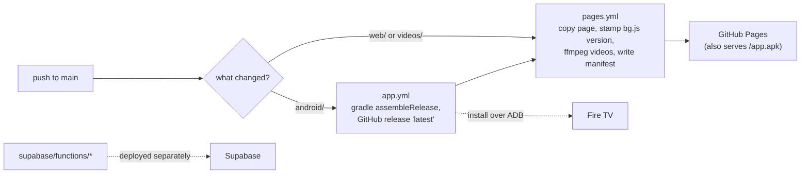

# Architecture

Four pieces: a TV app, a static page on GitHub Pages, two Supabase edge functions with a
Postgres database, and an optional Power Automate flow for a work calendar.

## Components

| Piece | Where | Role |
|---|---|---|
| TV app | `android/` | Wraps the page in a full screen WebView, passes remote buttons to it, exposes the app row (`window.TV`), redirects Home and wake to the dashboard, doubles as screensaver |
| Page | `web/index.html` | Draws everything; calls the data function every 5 minutes and Open-Meteo every 20 |
| Background | `web/bg.js` + `videos/` | Plays one clip on a loop; Up/Down switch clips; remembers the last one |
| Data function | `supabase/functions/tv-dashboard` | One authenticated endpoint that returns all personal data plus settings |
| Calendar receiver | `supabase/functions/work-calendar-ingest` | Accepts the work calendar from Power Automate and replaces the stored copy |

## A refresh, step by step

## Home button on Fire OS

Fire OS does not allow a third party launcher, and apps cannot intercept the Home key.
The app's accessibility service watches for the stock home screen and replaces it:

## Publishing

* Page changes reach the TV on its daily reload, or right away with ☰ Menu. The version stamp on `bg.js` avoids stale cached copies.
* App changes need a reinstall over ADB ([tv-setup.md](tv-setup.md)).
* Edge functions are deployed to Supabase directly (dashboard, CLI or MCP); the files here are the source of truth.

## Security model

* **No personal data in this repo.** Location, time zone, trips, subway stop and key hashes live in the private `tv_config` table. The Google Calendar link is the `GCAL_ICS_URL` function secret.
* **Two separate keys, stored only as SHA-256 hashes.** The TV key is held by the TV app (set once over ADB) and sent as `x-tv-key`. The ingest key lives in the Power Automate flow and is sent as `x-ingest-key`. Either can be rotated by updating its hash in `tv_config`.
* **Tables have row level security on with no policies**, so only the edge functions (service role) can read them.
* **Work calendar minimization:** the flow sends titles and times only; attendees, locations and bodies never leave Outlook.
* **The app row can only launch apps on its allowlist** (`TvBridge.APPS`).
