# Data and config

Everything personal is in one Supabase project: the settings row, the data tables the
dashboard reads, and one function secret.

## `tv_config` (settings)

One row (`id = 1`) with a `config` JSON column. Row level security is on with no policies,
so only the edge functions can read it. Edit it in the Supabase table editor or with SQL;
changes apply on the TV's next refresh (within 5 minutes).

```jsonc
{
  "tv_key_sha256":     "<sha256 of the TV key>",        // the TV sends the key as x-tv-key
  "ingest_key_sha256": "<sha256 of the ingest key>",    // Power Automate sends x-ingest-key
  "metrics_key_sha256": "<sha256 of the metrics key>",  // Gmail Apps Script sends x-metrics-key
  "timezone": "America/New_York",
  "location": { "lat": 0.0, "lon": 0.0 },               // for the weather
  "trips": [ { "name": "Somewhere", "start": "YYYY-MM-DD", "end": "YYYY-MM-DD" } ],
  "subway": {
    "stop_id": "M16",                                    // MTA GTFS stop id (without N/S)
    "name": "Station name",
    "label": "J M",                                      // shown before the station name
    "routes": ["J", "M", "Z"],
    "manhattan_next_stop": "M18",                        // next stop that means "toward Manhattan"
    "feeds": ["https://api-endpoint.mta.info/Dataservice/mtagtfsfeeds/nyct%2Fgtfs-jz"]
  },
  "quote_symbols": { "Bitcoin": "BTC-USD" }              // asset name -> market symbol
}
```

Rotate a key: generate a new random value, store its SHA-256 here, then give the new value to the
TV (see [tv-setup.md](tv-setup.md)) or to the flow (see [power-automate.md](power-automate.md)).

```sql
update tv_config set config = jsonb_set(config, '{tv_key_sha256}', to_jsonb(encode(sha256('NEW_KEY'::bytea), 'hex')))
where id = 1;
```

## Tables read by the dashboard

```mermaid
erDiagram
    tv_config { smallint id PK "always 1"  jsonb config }
    whoop_recovery { date recovery_date  numeric recovery_score  numeric hrv_rmssd_milli  numeric resting_heart_rate }
    whoop_sleep { timestamptz end_time  numeric duration_minutes  numeric performance_percentage }
    whoop_cycles { timestamptz start_time  numeric strain  numeric calories_kcal }
    whoop_workouts { timestamptz start_time  text sport_name  numeric strain }
    training_plan { text dow PK "Mon..Sun"  text training_type  text load }
    body_composition { timestamptz measured_at  numeric weight_kg  numeric body_fat_pct }
    nutrition_log { date logged_date  numeric calories_kcal }
    stocks_crypto_history { date snapshot_date  text asset_type  text asset_name  numeric quantity  numeric total_value }
    real_estate_history { date snapshot_date  text asset_name  text data_source  numeric home_value  numeric mortgage_balance }
    work_calendar_events { timestamptz start_time  timestamptz end_time  text title  boolean all_day }
```



| Table | Filled by | Used for |
|---|---|---|
| `whoop_*` | WHOOP data pipeline | Recovery ring, HRV, resting HR, sleep, strain |
| `training_plan` | Manual (one row per weekday) | Today's workout |
| `body_composition` | Smart scale sync | Weight, body fat, trend line |
| `tv_metrics` | Gmail Apps Script via tv-metrics-ingest | Unread inbox count (`gmail_unread`, Primary tab only) |
| `nutrition_log` | Meals logged in Luna | Calories eaten today, against today's WHOOP calories burned |
| `stocks_crypto_history` | Portfolio pipeline | Holdings; Stock and Crypto priced live, Retirement/Brokerage daily rows |
| `real_estate_history` | Portfolio pipeline | Home equity (average of the latest Zillow and Redfin values, minus mortgage) |
| `work_calendar_events` | `work-calendar-ingest` | Work meetings (replaced on every flow run) |

## Function secrets

| Secret | Used by | Value |
|---|---|---|
| `GCAL_ICS_URL` | tv-dashboard | Google Calendar → Settings → your calendar → Integrate calendar → **Secret address in iCal format** |
| `SUPABASE_URL`, `SUPABASE_SERVICE_ROLE_KEY` | both | Provided automatically by Supabase |

## Response of `tv-dashboard`

`GET https://<project-ref>.supabase.co/functions/v1/tv-dashboard` with header `x-tv-key`.

```jsonc
{
  "generatedAt": "2026-01-01T12:00:00Z",
  "settings":  { "timezone": "...", "location": { "lat": 0, "lon": 0 }, "trips": [] },
  "whoop":     { "recovery": {}, "recoveryTrend": [], "today": {}, "yesterday": {}, "sleep": {}, "lastWorkout": {} },
  "calendar":  [ { "title": "...", "start": "...", "end": "...", "allDay": false, "source": "personal | work" } ],
  "portfolio": { "total": 0, "change": 0, "changePct": 0, "holdings": [], "series": [], "homeEquity": 0 },
  "fitness":   { "today": { "training_type": "...", "load": "..." }, "body": { "latest": {}, "first": {}, "series": [] } },
  "trains":    { "station": "...", "label": "...", "manhattan": [ { "route": "J", "mins": 4 } ], "brooklyn": [] }
}
```

Each section fails independently: if one source is down, that section carries `{ "error": "..." }`
and the page hides it.
