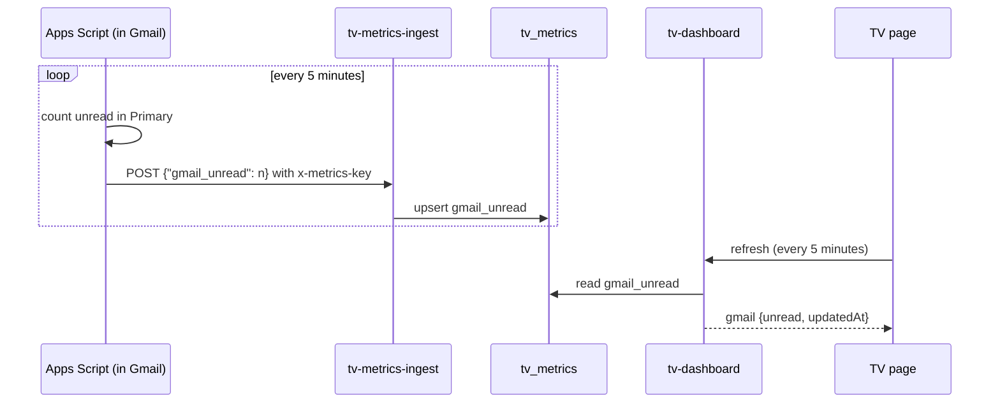

# Gmail unread count

A Google Apps Script in the Gmail account counts unread conversations in the inbox's Primary tab every
5 minutes and posts only that number to the `tv-metrics-ingest` function. No mail, subjects or
senders leave Gmail, and no Gmail password is stored anywhere.



## Setup

1. Open [script.google.com](https://script.google.com) signed in to the Gmail account, **New project**.
2. Replace the code with the script below. Put the metrics key in `KEY` (any random value whose
   SHA-256 is in `tv_config.metrics_key_sha256`, see [data.md](data.md)).
3. Run `push` once and allow access when Google asks (it needs to read Gmail and call an outside URL).
4. Triggers (clock icon) → **Add Trigger** → function `push`, time driven, minutes timer, every 5 minutes.

```js
const URL = "https://<project-ref>.supabase.co/functions/v1/tv-metrics-ingest";
const KEY = "<metrics key>";

function push() {
  // unread conversations in the Primary tab only (not Promotions, Social, Updates, Forums)
  const unread = GmailApp.search("in:inbox is:unread category:primary", 0, 500).length;
  const res = UrlFetchApp.fetch(URL, {
    method: "post",
    contentType: "application/json",
    headers: { "x-metrics-key": KEY },
    payload: JSON.stringify({ gmail_unread: unread }),
    muteHttpExceptions: true,
  });
  console.log(unread, res.getResponseCode(), res.getContentText());
}
```

On the TV the count shows above the calendar. It fades if no update has arrived for two hours
(the trigger stopped or the script lost access).

To stop: delete the trigger, or the whole project, in Apps Script.
