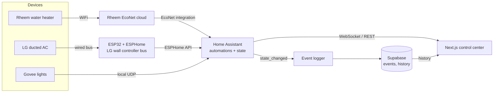

# Home control center

One place to run the home: water heater, air conditioning and lighting, all driven through
Home Assistant and shown in a custom Next.js UI, with every state change logged to Supabase for
history and analytics.

**[Interactive architecture diagram](home-architecture.html)** (open the HTML file in a browser;
source in [`home-architecture.json`](home-architecture.json))



## Principles

1. **Home Assistant is the source of truth.** It owns device state, automations and schedules.
   Nothing else talks to devices directly.
2. **The UI only talks to Home Assistant.** Live state comes over the HA WebSocket API; commands go
   through HA service calls. Swapping a device never touches the UI.
3. **Local first.** Local control wherever the hardware allows it; cloud only where there is no
   alternative.
4. **Everything is logged.** A small logger subscribes to HA state changes and writes them to
   Supabase, so the UI can show history, trends and energy patterns.

## Components

| Layer | Component | How it connects | Notes |
|---|---|---|---|
| Device | Rheem water heater | EcoNet WiFi module to the Rheem cloud, then the HA EcoNet integration | Cloud polled: some lag, depends on Rheem uptime |
| Device | LG ducted AC | ESP32 running ESPHome on the wired wall controller bus, then the ESPHome API | Fully local; needs low voltage wiring at the wall controller |
| Device | Govee lights | Govee LAN API over local UDP | Enable LAN control per device in the Govee app |
| Middleware | Home Assistant | Hub for all integrations | Automations, scenes, schedules |
| Data | Event logger | Subscribes to `state_changed` on the HA WebSocket | Writes events to Supabase |
| Data | Supabase | Postgres, same project as the TV dashboard | Event log, history, analytics views |
| App | Next.js control center | HA WebSocket and REST for live control; Supabase for history | Phone, laptop and TV |

## Folders

```
control-center/     Next.js control center
homeassistant/      HA configuration, automations, scenes
esphome/            ESP32 firmware config for the LG AC bridge
services/logger/    HA to Supabase event logger
supabase/           shared with the TV dashboard (migrations and functions)
```

## Roadmap

- [ ] Stand up Home Assistant and add the three device integrations
- [ ] Build and flash the ESP32 bridge for the LG ducted AC
- [ ] Design the Supabase schema for events and history
- [ ] Build the event logger
- [ ] Scaffold the Next.js control center with live HA state
- [ ] Add history and analytics views
- [ ] Show home status and quick controls on the TV dashboard

## Configuration

Secrets and personal settings (HA URL and long lived token, Supabase keys, device IPs) stay out
of the repo, in `.env.local` files and Supabase secrets.

## Updating the diagram

The diagram is generated with [Archify](https://github.com/tt-a1i/archify). Edit
`docs/home-architecture.json`, then from the repo root:

```bash
node <archify>/bin/archify.mjs finalize architecture docs/home-architecture.json docs/home-architecture.html --quality showcase
```
