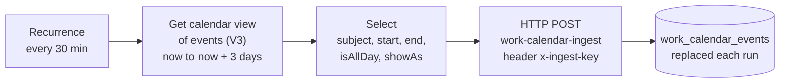

# Work calendar flow (Power Automate)

When a work Microsoft 365 account does not allow publishing a calendar, a scheduled Power
Automate flow can send the next few days of meetings to `work-calendar-ingest`. It sends
**titles and times only**; attendees, locations and meeting bodies never leave Outlook.

> Check that your organization's policy allows copying calendar data to a personal service
> before setting this up.

## Steps (make.powerautomate.com, new designer)

1. **Create → Scheduled cloud flow.** Repeat every **30 minutes**.
2. **Get calendar view of events (V3)** (Office 365 Outlook)
   * Calendar Id: `Calendar`
   * Start Time: expression `utcNow()`
   * End Time: expression `addDays(utcNow(), 3)`
3. **Select** (Data Operation)
   * From: `value` from the previous step
   * Map, one row per field (value via the **fx** expression editor):

     | Key | Value |
     |---|---|
     | `subject` | `item()?['subject']` |
     | `start` | `item()?['start']` |
     | `end` | `item()?['end']` |
     | `isAllDay` | `item()?['isAllDay']` |
     | `showAs` | `item()?['showAs']` |
4. **HTTP**
   * Method: `POST`
   * URI: `https://<project-ref>.supabase.co/functions/v1/work-calendar-ingest`
   * Headers: `x-ingest-key` = *your ingest key*, `Content-Type` = `application/json`
   * Body: expression **`string(body('Select'))`**
5. **Save → Test → Manually → Run flow.** The HTTP step should return `200` with `{"stored": N}`.

## Notes

* **Body must be the `string(...)` expression.** Passing the Select output token directly makes Power Automate stream the body, and it arrives empty (the receiver answers `400`).
* The flow can show "succeeded" even when the receiver rejected the data; check the HTTP step's output body if meetings stop appearing.
* Events marked **Free** are skipped. Duplicates (same title and start) show once.
* The receiver replaces all stored events on every run, so cancelled meetings disappear within 30 minutes.
* Rotate the ingest key: put the SHA-256 of a new value in `tv_config.ingest_key_sha256`, then update the header in the flow.
